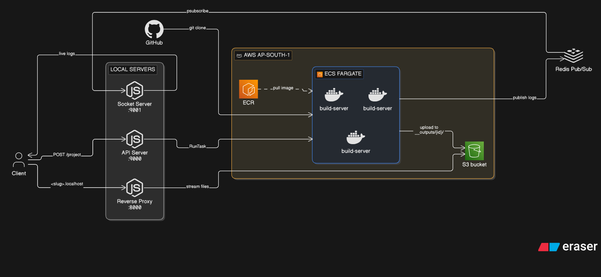
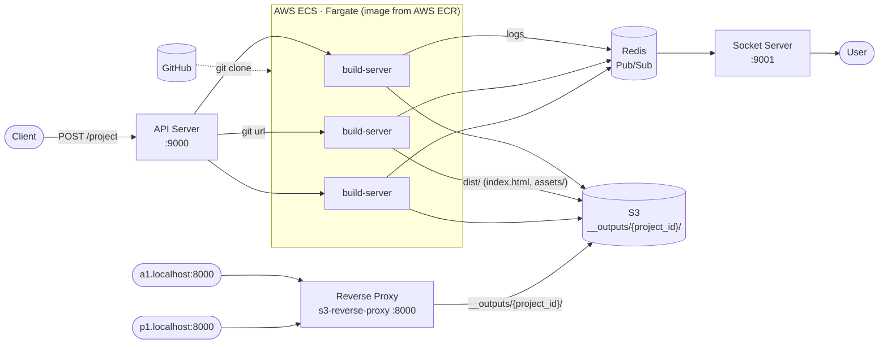
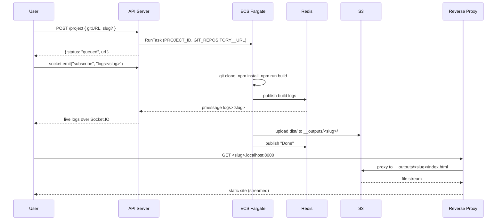

# PodShip

A self-hosted, Vercel-style deployment platform. Give it a GitHub repo URL and it builds the project in an isolated container, hosts the output on S3, and serves it on its own subdomain while streaming build logs live.

## Architecture

Same architecture as a Mermaid diagram

### Deploy flow

## Components

- **Build server** (`build-server/`): a Docker image run as an ECS Fargate task per deploy. It clones the repo, runs `npm install` and `npm run build`, uploads `dist/` to S3 with correct content types, streams logs to Redis, and exits.
- **API server** (`api-server/`): an Express REST API that accepts a GitHub URL (and an optional custom slug), generates a project slug, and launches the build task with per-deploy environment overrides. It also runs a Socket.IO server that relays build logs from Redis to subscribed clients.
- **S3 reverse proxy** (`s3-reverse-proxy/`): maps `<slug>.localhost:8000` to `__outputs/<slug>/` in S3 and streams responses instead of buffering files in memory.

## Tech Stack

Node.js · Express · Docker · AWS ECS Fargate · Amazon ECR · Amazon S3 · Redis · Socket.IO
